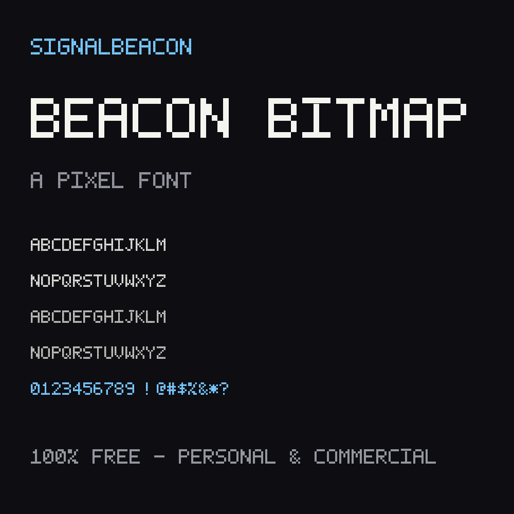
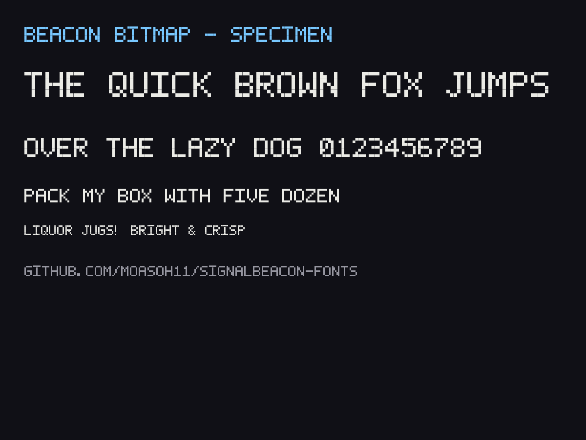

# SignalBeacon Fonts

Free pixel and retro display fonts from the SignalBeacon micro foundry.

## Beacon Bitmap

A crisp 5x7 pixel font for games, zines, stream overlays and lo-fi design. Hand-plotted on a grid and built to stay legible at tiny sizes.

- 84 glyphs: A-Z, 0-9 and common punctuation (lowercase maps to caps)
- Installs on Windows, Mac and Linux (standard .ttf)
- 100% free for personal and commercial use

### Download

Grab `BeaconBitmap-Regular.ttf` from this repo or the latest release, then double-click to install.

### License

Free for personal and commercial use. You may use this font in games, videos, zines, overlays, logos and printed goods. You may not resell or redistribute the font file itself, modified or unmodified, as a font. See LICENSE.txt.

---

More fonts in the works. Also on [Payhip](https://payhip.com/SignalBeacon) and [Ko-fi](https://ko-fi.com/signalbeacon).
